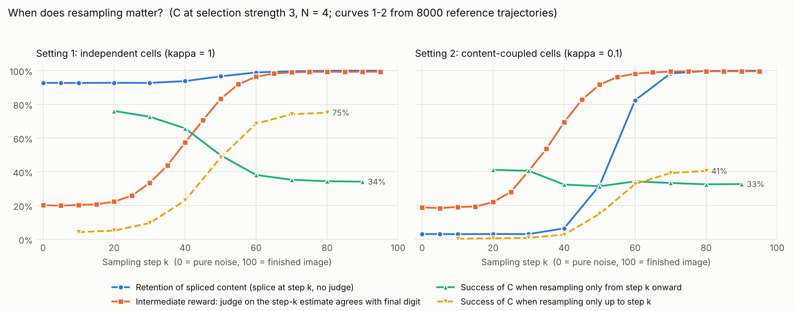

# Region-wise resampling during diffusion sampling ("stitching")

A small experiment on one question: when a batch of diffusion samples is steered by
copying good samples and dropping bad ones, what changes if the unit that gets copied is a
**region** of the image instead of the whole image?

Each region is scored on its own, each region picks its own source sample, and the pieces
are joined into a new sample that keeps denoising. On two-cell images of handwritten digits
this had a clearly higher success rate than whole-sample resampling at the same compute.

**Read the note: [paper.md](paper.md).** It is short and written to be read without the code.

This is a toy-scale study (a 3.86M-parameter model on 28×56 MNIST digits). Nothing here has
been tested on a real image model. See the limitations section of the note.

## Main result

Success rate with 4 samples per batch, best configuration of each method, mean of 3 seeds.
The target is "left digit is 1, right digit is 3".

| Method | Setting 1: independent cells | Setting 2: coupled content | Setting 3: coupled style |
|---|---|---|---|
| A: independent sampling | 4.1% | 0.5% | 4.1% |
| D-stitch: stitch the finished images | 34.8% | 31.9% | 15.2% |
| B: whole-sample resampling | 53.1% | 12.9% | 61.2% |
| **C: region-wise resampling (stitching)** | **78.6%** | **40.7%** | **76.4%** |
| B with 8 samples per batch (2× compute) | 87.6% | 36.4% | 92.8% |



## What is in this repository

| Path | Content |
|---|---|
| `paper.md` | The technical note |
| `figures/` | The two figures of the note (English labels), drawn by `make_figures_en.py` |
| `results.json`, `timing.json`, `level3.json` | All numbers behind the note |
| `smc.py` | The samplers: A, B, C and the post-hoc control D, plus the metrics |
| `unet.py`, `diffusion.py`, `train_diffusion.py`, `train_classifiers.py`, `common.py` | Model, data, training (settings 1 and 2) |
| `run_main.py`, `make_table.py`, `build_results_json.py`, `check_lam0.py`, `pool_lam0.py` | Main comparison and sanity checks (settings 1 and 2) |
| `timing.py`, `timing_report.py` | Splice-retention and reward-reliability curves, resampling-schedule sweep |
| `level3_*.py` | Setting 3 (shared style): data, classifiers, training, the same measurements |
| `*.ps1` | PowerShell pipelines that run the steps in order |
| `results/`, `level3/results/`, `logs/`, `checkpoints/*.json` | Raw per-configuration results and training/acceptance metrics |
| `*.png` in the root and in `results/` | Sample grids, and the original figures with Chinese labels |

Names used in the code and data files:

| In the note | In the code |
|---|---|
| Setting 1 (independent cells) | `kappa = 1` |
| Setting 2 (coupled content) | `kappa = 0.1` |
| Setting 3 (coupled style) | `level3` |
| Selection strength λ | `lam` |
| Judge / evaluator | `judge` / `evaluator` |
| Unrecognisable sample | `waste` |

**Not included:** model checkpoints (three diffusion models of about 31 MB each, plus the
classifiers), the MNIST download, and cached reference trajectories. All of them are
regenerated by the pipelines below.

## Reproducing

The experiments were run on Windows with one laptop GPU (RTX 5080), Python 3.12 and
PyTorch 2.11 (CUDA 12.8 build). Install PyTorch for your CUDA version first, then
`pip install -r requirements.txt`.

The pipelines are PowerShell scripts and expect the Python interpreter at `.venv\python.exe`
inside the repository. If yours is somewhere else, change the `$py` line near the top of
each script. On other systems, run the Python commands listed in the scripts in the same
order.

```powershell
# Settings 1 and 2: classifiers, two diffusion models, main comparison (about 4-5 hours)
powershell -ExecutionPolicy Bypass -File reproduce.ps1

# Retention / reliability curves and the resampling-schedule sweep (needs the models from above)
powershell -ExecutionPolicy Bypass -File pipeline_timing.ps1

# Setting 3: classifiers, diffusion model (about 100 minutes of training), both experiments
powershell -ExecutionPolicy Bypass -File level3_pipeline.ps1

# Redraw the figures of the note from the JSON files (no GPU needed)
python make_figures_en.py
```

Run one GPU job at a time. The setting 3 pipeline can be restarted after an interruption
and skips finished steps.

## Use of AI

The code, the experiment runs, the collection of results, the literature search and the
drafting of the text were done by AI tools (Claude and Claude Code; the literature search
was cross-checked with DeepSeek). The author posed the question, decided the direction and
trade-offs of the experiments, reviewed all results and text, and is responsible for the
content.

## License

MIT, see [LICENSE](LICENSE).
