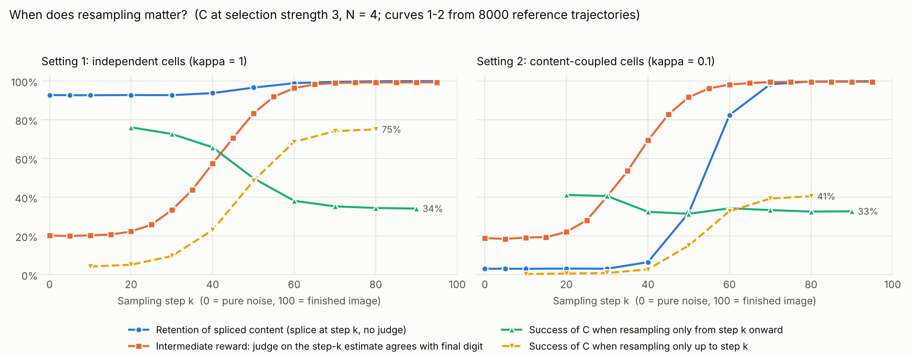
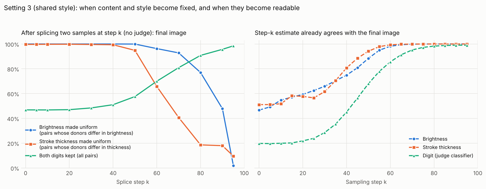

# Region-wise Resampling During Diffusion Sampling: A Small Digit Experiment

Xiangwan · November 2026 · technical note, not peer reviewed

## Abstract

One family of inference-time guidance methods for diffusion models generates a batch of samples together and, during sampling, copies the samples that score well and drops the ones that score badly. The unit that gets copied is the whole sample. This note studies what happens when the unit is a region instead: each region is scored on its own, each region picks its own source sample, and the regions taken from different samples are joined into a new sample that keeps denoising. We call this *stitching*. In three experiments on two-cell images of handwritten digits, stitching had a clearly higher success rate than whole-sample resampling at the same compute. With 4 samples per batch the rates were 79% vs 53%, 41% vs 13%, and 76% vs 61%. Most of the gain comes from resampling in the middle of sampling, roughly steps 30 to 60 out of 100 in the first two experiments and somewhat later in the third. When the two regions must share a style, stitching during sampling still works, while stitching finished images does not. All experiments use a small synthetic setup; nothing here has been tested on a real image model.

## 1 Introduction

Inference-time guidance leaves the model's parameters unchanged and uses a reward function during sampling to push samples toward a desired property. One family of methods generates a batch of samples together, scores each sample's predicted result at some intermediate steps, copies the high-scoring samples and drops the low-scoring ones. The literature calls this step *resampling*, and we use that word below. In these methods the unit of resampling is the whole sample.

When the target splits into separate conditions on several regions, whole-sample resampling needs one sample in the batch that satisfies all of them at once, and the chance of that falls quickly as the number of regions grows. Fields such as weather forecasting meet the same problem when they correct a forecast with observations. Their answer is to divide space into blocks and to score and resample each block separately (the *block particle filter*), at the price of possible inconsistency where blocks meet. To our knowledge this has not been applied to the sampling process of a diffusion model.

This note applies region-wise resampling during diffusion sampling and looks at when it works, in a small setting where everything can be controlled. The direct motivation is a common manual workflow in image creation: take the best local parts from several outputs of the same batch and composite them into one image with masks. The note contains three things:

- Region-wise resampling applied to diffusion sampling, compared with whole-sample resampling and with post-hoc selection at the same compute, in three settings that differ in how the regions depend on each other.
- Two curves over the sampling steps: how reliable the intermediate reward is, and how much of a spliced-in region the model keeps. Together they explain which resampling steps matter.
- A measurement of the order in which digit content, stroke thickness and brightness become fixed during sampling, and what that means for stitching.

## 2 Method

Each batch generates several samples together. At every step a diffusion model can give an estimate of the final image (the *estimate*, usually written x̂₀). Every few steps a classifier, which we call the *judge*, scores each sample's estimate; a higher score means closer to the target. We call this score the *intermediate reward*.

**Whole-sample resampling (B).** The more a sample's reward has risen since the previous resampling step, the more likely it is to be copied; samples that fall behind are dropped. One parameter, the selection strength λ, sets how strong the selection is. Copying and dropping act on whole samples, and the reward is the sum of the per-region rewards.

**Region-wise resampling (C, stitching).** The image is divided into regions. Each region is scored separately and picks its own source sample by the same rule as B. Each region of a new sample is copied from the same position in the source it picked. The regions are joined directly along the boundary with no blending, and denoising continues. The model compute is the same as for B.

**Controls.** Independent sampling (A) does no resampling. Post-hoc selection (D) works on the finished batch from A and does not touch the sampling process. It has two forms: D-whole takes the one image with the highest total reward; D-stitch takes, for each region, the piece with the highest reward and joins the pieces into one image.

| Method | During sampling | After sampling | Unit |
|---|---|---|---|
| A independent | nothing | nothing | none |
| B whole-sample resampling | resample by reward | nothing | whole sample |
| C region-wise resampling (stitching) | resample by reward | nothing | region |
| D-whole | nothing | select by reward | whole sample |
| D-stitch | nothing | select by reward and join | region |

**Exact rule, for readers who want it.** The reward r is the judge's log-probability of the target digit, computed on the estimate; for a whole sample it is the sum over the two cells. At a resampling step each sample (B) or each cell (C) gets weight proportional to exp(λ · (r − r_prev)), where r_prev is the reward of the same lineage at the previous resampling step (at step 0 for the first one). New samples (B) or new cells (C) are drawn from the batch with these weights, with replacement, at every resampling step. This is the difference potential of Feynman-Kac steering with multinomial resampling. Every method uses exactly one model call per sample per step. The code is in `smc.py`.

## 3 Experimental setup

**Data.** Images are 28×56 grayscale, made of two 28×28 MNIST digits side by side, using only the digits 0 to 4. The two cells are the two regions. The three settings differ in how the cells depend on each other:

| Setting | Relation between the cells | Success means | Chance of the target without guidance |
|---|---|---|---|
| 1: independent | the two digits are independent | both digits are the target | 4% |
| 2: coupled content | in 92% of training images the two digits are the same; the target is two different digits | both digits are the target | 0.4% |
| 3: coupled style | digits are independent; each image gets one of four styles (bright or dark, thin or thick strokes), the same in both cells | both digits are the target, and brightness and thickness agree across the cells | 4% |

The target is always "left cell is 1, right cell is 3". In setting 3 two randomly chosen images have different styles three times out of four, which is harsher than real generation from a single prompt.

In the code and the result files, settings 1 and 2 are `kappa = 1` and `kappa = 0.1`, and setting 3 is `level3`.

**Model.** Each setting has its own small diffusion model (DDPM, UNet architecture, about 3.86 million parameters), trained for 35,000 steps. Generating an image takes 100 steps, with fresh random noise added at every step. The model takes no prompt or other conditioning, so the target can only be reached through resampling.

**Judge and evaluator.** The judge that scores samples during sampling and the evaluator that computes the final metrics are two digit classifiers with different architectures, trained separately. Both are above 99% accurate on clean images. Setting 3 also has a style evaluator, used only for the final metrics. The judge looks only at digits and knows nothing about style, so whether the styles agree is left entirely to the model.

**Comparison.** Batches have N = 4 samples, and resampling happens every 10 steps. B and C are tuned over the same grid of selection strengths and resampling schedules, the best configuration of each is rerun with 3 random seeds, and every configuration uses 1000 batches. All final metrics come from the evaluator.

**Sanity checks.** With selection strength 0, B gives the same results as A. In setting 1, C also matches A. In setting 2, C is higher than A (1.8% vs 0.5%): even with no selection, stitching breaks the model's tendency to make the two digits the same. This effect accounts for about 1 percentage point of C's final success rate. In setting 3, C with strength 0 leaves the success rate unchanged but lowers style agreement over all samples (87% vs 99.8% for A), because halves swapped late in sampling can no longer be reconciled (Section 4.3).

## 4 Results

### 4.1 Main comparison

In all 24 comparisons with matching configurations, stitching had a higher success rate than whole-sample resampling. The table shows each method's best configuration, averaged over 3 seeds.

| Method | Setting 1 | Setting 2 | Setting 3 |
|---|---|---|---|
| A independent, N = 4 | 4.1% | 0.5% | 4.1% |
| D-stitch, N = 4 | 34.8% | 31.9% | 15.2% |
| B whole-sample resampling, N = 4 | 53.1% | 12.9% | 61.2% |
| **C stitching, N = 4** | **78.6%** | **40.7%** | **76.4%** |
| B whole-sample resampling, N = 8 | 87.6% | 36.4% | 92.8% |
| Equivalent batch size of C | 6.7 | 8.7 | about 5.6 |

For A, B and C the numbers are per-sample success rates. D produces one image per batch, and the table gives the success rate of that image. Samples within a batch of B or C are very similar to each other, so the per-sample rate and the rate of "at least one success in the batch" differ by at most 4 percentage points. The equivalent batch size is the number of samples per batch that B would need to match C's success rate, estimated from B's success rates at 4 and 8 samples per batch. Standard deviations across seeds are between 0.3 and 2.1 percentage points.

**Setting 1.** B needs one sample in the batch with both cells right. C only needs each cell to be right in some sample. B's hit rates for the left and right cells are 75% and 71%; C's are 88% and 89%. B's success rate hardly responds to the selection strength (a tenfold increase moves it from 50% to 51%), which says its bottleneck is too few candidates, not too weak a selection.

**Setting 2.** C's success rate is about three times B's. But D-stitch reaches 31.9% with no extra compute, which is above B. The success criterion in this setting only looks at the two digits separately, so joining finished halves is never counted as a failure. Most of the gain here therefore comes from recombination itself, and intervening during sampling adds only about 9 percentage points on top. Section 4.2 gives the reason: content spliced in too early is rewritten by the model back to two equal digits.

**Setting 3.** Once the styles must agree, post-hoc stitching loses its advantage. D-stitch gets the digits right 36% of the time, but only 15.2% once style agreement is required, level with D-whole (15.4%). C gets the digits right 79.6% of the time and 76.4% with style agreement, still about 15 percentage points above B. The style mismatches in C come almost entirely from stitching after step 60: when resampling is restricted to steps 30 to 60, style agreement among successful samples is above 99%. That restricted schedule has a much lower success rate, though (53% against 78%; see Section 4.2).

**Cost.** Resampling lowers the diversity within a batch. Measured as the mean distance between successful samples, in settings 1 and 2 independent sampling gives about 11, B gives 3.6 to 4.3, and C gives 4.8 to 5.0. Stitching does not noticeably increase unrecognisable samples: their share is at most 1% in every setting, about the same as for B.

### 4.2 When resampling matters

*Figure 1. Blue: share of spliced pairs in which both halves keep their digit. Orange: how often the judge's reading of the step-k estimate matches the final digit (chance is 20%). Green and yellow: success rate of C when resampling is restricted to steps from k onward, or to steps up to k. Data: `timing.json`.*

Two quantities that change over the sampling steps explain which resampling steps matter.

**Retention of spliced content.** First generate two images independently and record the whole process (a *reference trajectory* each). Then repeat the process, but at step k join the left half of one with the right half of the other, and use the same random noise as before in every later step. Any change in the final result can then only come from the splice. Retention is the share of cases in which both cells still end as the same digits as in their reference results, counting only pairs whose two reference digits differ. This measurement involves no judge; it only shows whether the model changes what was spliced in. With the setting 2 model, retention is about 3% for a splice at step 30 or earlier, and in about 90% of cases the image is rewritten to two equal digits. Retention is 32% at step 50, 83% at step 60 and 98% at step 70. With the setting 1 model, where the cells are independent, retention is already 93% for a splice made in pure noise.

**Reliability of the intermediate reward.** On the reference trajectories, every 5 steps, the judge classifies the current estimate, and we count how often this matches the final result. The numbers here are for the setting 2 model; the setting 1 model is a few steps later (Figure 1). Before step 20 the match rate equals random guessing (20%). It reaches 50% at about step 35 and 90% at about step 50. The judge is confident even while it is unreliable: at steps 10 to 15 it gives more than 90% confidence for about six cells in ten. Early resampling therefore copies samples according to noise. That intermediate rewards are unreliable early in denoising has been reported before (Section 5).

**Three phases.** Before about step 30 the reward is unreliable, and when the cells are coupled the spliced content is not kept either. From about step 30 to 60 the reward becomes reliable while the content is not yet fully fixed; this is where resampling can steer the result. After about step 60 the content is fixed, and resampling can only select among results that are already decided. Selection alone is still useful, but it is what post-hoc selection does too. The table shows C's success rate under restricted resampling schedules (selection strength 3, one seed, standard error about 1.5 percentage points).

| Resampling at steps | Setting 1 | Setting 2 |
|---|---|---|
| 10 to 30 only | 9.6% | 0.9% |
| 10 to 50 only | 48.5% | 15.1% |
| 10 to 60 only | 68.6% | 32.8% |
| 10 to 70 only | 74.2% | 39.4% |
| 70 to 90 only | 35.3% | 33.4% |
| 50 to 90 only | 49.9% | 31.5% |
| 30 to 90 only | 72.7% | 40.7% |
| all (10 to 90) | 75.0% | 41.0% |
| for reference: D-stitch | 34.8% | 31.9% |

Resampling only from step 70 on gives the same success rate as stitching finished images. Resampling only up to step 30 gives almost nothing. Most of the difference between the two is made between steps 30 and 60.

The boundaries of this window are not sharp, and the window is not the same in every setting. In setting 3 the digits become readable later (the judge's match rate reaches 50% at about step 42 and 90% at about step 64), and the schedules compare as follows (selection strength 10, one seed):

| Resampling at steps | Setting 3: digits right | Setting 3: digits right and styles agree |
|---|---|---|
| 30 to 60 only | 53.5% | 53.1% |
| 30 to 90 | 76.4% | 71.7% |
| all (10 to 90) | 80.8% | 78.0% |

Here the late steps contribute about 19 percentage points, and starting at step 10 instead of step 30 adds about 6 more. We have not isolated the reason for the second effect.

### 4.3 The order in which content and style become fixed

*Figure 2. Left: after splicing two samples at step k, how often the model makes the two cells' brightness or stroke thickness the same, and how often both digits survive. Right: how early each attribute can be read from the estimate. Data: `level3.json`.*

With the setting 3 model we splice two halves with different styles at step k, in the same way as above. The model either changes the two cells to one style, or leaves the styles mismatched until the end. Taking "the share that gets unified falls to one half" as the point at which an attribute is fixed gives:

| Attribute | Fixed at about step |
|---|---|
| Digit content | 55 to 60 |
| Stroke thickness | 65 |
| Overall brightness | 90 |

The model can still unify brightness late in sampling, so brightness is no obstacle to stitching in the middle of sampling. Stroke thickness is fixed at almost the same time as digit content, which creates a trade-off. For a splice at step 50, thickness is unified 95% of the time, but both digits are kept only 58% of the time. For a splice at step 70, both digits are kept 81% of the time, but thickness is unified only 41% of the time. When the model unifies style it rewrites one of the cells, and the digit in the rewritten cell often changes with it.

Being readable early is not the same as being fixed early. Brightness and thickness can be read from the estimate earlier than the digit (Figure 2, right), yet they stay changeable for longer.

Despite the trade-off, method C loses only about 3 percentage points of success to style mismatch in setting 3. There are two possible reasons, neither tested separately. First, C selects again every 10 steps, so a rewritten cell can be replaced at the next resampling step. Second, after several rounds of resampling most samples in a batch descend from the same sample and already share a style.

## 5 Related work

All the components used here already exist. Whole-sample resampling comes from inference-time guidance for diffusion models, and region-wise resampling comes from state estimation (correcting forecasts with observations, as in weather forecasting). This note uses the second inside the first and measures when it takes effect.

| Direction | Representative work | Relation to this note |
|---|---|---|
| Whole-sample resampling for diffusion models | [Feynman-Kac steering](https://arxiv.org/abs/2501.06848); [Wu et al. 2023 (TDS)](https://arxiv.org/abs/2306.17775) | This is method B; the unit of resampling is the whole sample |
| Improvements to whole-sample resampling | [VASR](https://arxiv.org/abs/2604.06779); [LiDAR](https://arxiv.org/abs/2602.03211); [CREPE](https://arxiv.org/abs/2509.23265) | VASR changes the resampling scheme to reduce the loss of diversity within a batch; LiDAR points out that rewards computed on intermediate estimates are biased; CREPE replaces resampling with replica exchange. The unit is always the whole sample; in principle these can be combined with region-wise resampling |
| Region-wise resampling in state estimation | [Rebeschini and van Handel 2015](https://arxiv.org/abs/1301.6585); [local particle filters in geophysical data assimilation](https://arxiv.org/abs/2507.07103); [Twisted Block Particle Filters](https://arxiv.org/abs/2611.28848) | Block (local) particle filters and their theory. Method C applies this idea to diffusion sampling |
| Resampling for chunk-wise generators | [LatticeSMC](https://arxiv.org/abs/2610.02774) | Concerns music, dance and video generated chunk by chunk, and asks whether to resample at chunk boundaries or at denoising steps. The unit of resampling is the whole sequence; nothing is cut in space |
| Local refinement | [LoTTS](https://arxiv.org/abs/2511.19917) | Locates defective regions within a single image and regenerates them locally. Selection between candidates is at the level of whole images; regions are not combined across samples |
| Evolutionary recombination for diffusion models | [Diffusion Crossover](https://arxiv.org/abs/2604.14790); [Jajal et al. 2025](https://arxiv.org/abs/2506.00299) | The first interpolates the noise sequences of two images globally, with a human choosing; its text conjectures that splicing noise sequences in space would not work, but does not test it. The second treats the model as a black box and searches in latent space |
| Manual or specified region operations | inpainting, regional prompts, latent compositing | The first repairs after generation and the other two specify before generation; all need the regions to be drawn by hand. This note looks at automatic selection during sampling |

We ran two independent literature searches and found no work that does region-wise resampling of samples during diffusion sampling. The searches covered arXiv titles and abstracts only and no papers under review, so similar work may exist. The most recent paper in the table was posted on 21 November 2026.

**Difference from local refinement.** LoTTS finds a defective region inside one image, adds noise to that region and denoises it again, which costs extra denoising steps. Stitching recombines candidates that are already in the batch and adds no model calls. The two have not been compared directly at equal compute.

**Relation to work on resampling timing.** LatticeSMC has already reported that intermediate rewards are unreliable early in denoising and reliable late, and LiDAR notes that rewards computed on intermediate estimates are biased. The observation about reward reliability in Section 4.2 agrees with these and is not a new finding. What this note adds is the retention curve for spliced content and the reading of the two curves together. LatticeSMC studies sequences generated in chunks over time and does not recombine regions in space.

**Relation to the theory of block particle filters.** Rebeschini and van Handel prove that when positions far apart are only weakly related, the error of a block particle filter does not grow with the size of the problem, at the price of an error near the boundaries between blocks. Our experiments fit both points: the stronger the coupling between regions, the smaller the advantage of stitching during sampling over stitching afterwards (setting 2), and failed samples show up as inconsistency between regions (setting 3).

**Possible applications.** Region-wise resampling needs a reward for each region. Physical fields with local observations provide one naturally: each region can be scored by the observations near it. Wildfire spread already has [particle filters with spatial partitioning](https://doi.org/10.1145/3099471) and [diffusion-based data assimilation](https://arxiv.org/abs/2510.15954); we did not find the two combined.

## 6 Limitations

The conclusions hold for one small synthetic setup. Carrying them over to real image models needs further testing.

- **Scale.** The diffusion model has about 3.86 million parameters, and the images are 28×56 grayscale handwritten digits with five classes. Only one model was trained per setting.
- **The judge and the regions are given.** The judge is nearly perfect on clean images, and the regions are two fixed cells whose boundary falls on blank background. How to choose regions in real images, and where region-wise rewards would come from, is not addressed.
- **Only two regions.** How the advantage of stitching changes with the number of regions was not measured.
- **The baseline is the most basic whole-sample resampling.** Most existing improvements (such as resampling schemes with less randomness) do not depend on the unit of resampling and should in principle apply to stitching as well. How the gap changes when both sides use them was not measured.
- **Coarse measure of consistency.** Style in setting 3 has only two levels of brightness and two of thickness, with clear differences. Subtler inconsistencies would not show up in this measure.
- **The model takes no prompt.** In setting 3 each image gets a random style. With a prompt, images in a batch share more of their style; that case was not measured.
- **Diversity.** Like whole-sample resampling, stitching makes the samples in a batch more alike. When several different results per batch are wanted, this is a real cost.
- **Schedules were compared on one seed.** The schedule tables in Section 4.2 use a single seed each; only the best configurations in Section 4.1 were repeated over three seeds.

## Statement on the use of AI

The experiment code, model training, experiment runs, collection of results, literature search and drafting of the text were all done by AI tools (Claude and Claude Code; the literature search was cross-checked with DeepSeek). The author posed the research question, decided the direction and trade-offs of the experiments, reviewed all results and text, and is responsible for the content of this note.
